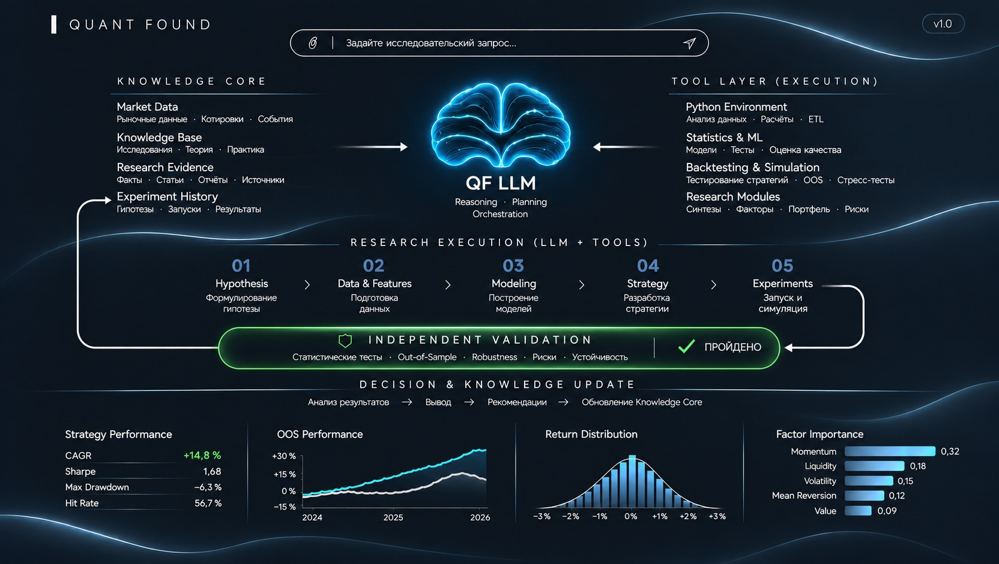

 

---

## 01. ABOUT

**Quant Found** is an independent quantitative research and engineering initiative focused on systematic financial research, market intelligence and the development of data-driven trading systems.

The project brings together market data infrastructure, quantitative research, statistical modeling, machine learning and systematic trading within a unified research environment.

Its core objective is to identify, evaluate and validate repeatable statistical relationships in financial markets and transform robust findings into systematic strategies.

Quant Found is built around four interconnected components:

- **QF LLM** — an intelligence and orchestration layer connecting research knowledge, computational tools and analytical workflows.
- **Knowledge Core** — a structured foundation for market data, research evidence, accumulated knowledge and experiment history.
- **Tool Layer** — computational infrastructure for data processing, statistical analysis, machine learning, backtesting and simulation.
- **Independent Validation** — a dedicated evaluation process focused on statistical significance, robustness, out-of-sample performance and risk.

Together, these components establish a unified environment for quantitative investigation, experimentation and evidence-based decision-making.

---

## 02. SYSTEM ARCHITECTURE

Quant Found is organized as an interconnected research system in which intelligence, knowledge and computational capabilities operate within a continuous research lifecycle.

Quant Found Research OS — System Architecture

### 2.1. QF LLM — Intelligence Core

QF LLM serves as the central reasoning and orchestration component of the research system.

Its responsibilities include:

- Research request interpretation.
- Contextual reasoning and analytical planning.
- Knowledge retrieval and contextualization.
- Hypothesis formulation.
- Research tool orchestration.
- Experiment coordination.
- Interpretation of statistical results.
- Analytical conclusions and recommendations.
- Research knowledge management.

The intelligence layer coordinates research activities while relying on deterministic computational tools for data processing, statistical calculations and validation.

### 2.2. Knowledge Core

Knowledge Core provides the persistent information foundation of Quant Found.

It connects four primary knowledge domains.

**Market Data**
- Historical and real-time market data.
- Prices, quotations and market events.
- Structured datasets.
- Market observations.

**Knowledge Base**
- Quantitative research methodologies.
- Statistical concepts and models.
- Financial theory.
- Research documentation.

**Research Evidence**
- Academic publications.
- Research papers and reports.
- Empirical observations.
- Source provenance and traceability.

**Experiment History**
- Research hypotheses.
- Experiment configurations and results.
- Statistical findings.
- Accepted and rejected hypotheses.
- Historical research decisions.

The Knowledge Core preserves relationships between datasets, hypotheses, experiments, models and validation results, making research reproducible and cumulative.

### 2.3. Tool Layer — Computational Infrastructure

The Tool Layer provides the computational capabilities required to conduct quantitative research.

**Python Environment**
- Data processing and analysis.
- Computational workflows.
- ETL operations.
- Infrastructure integration.

**Statistics & Machine Learning**
- Statistical modeling.
- Hypothesis testing.
- Regression and classification.
- Feature engineering.
- Model evaluation.

**Backtesting & Simulation**
- Historical strategy testing.
- Out-of-sample evaluation.
- Transaction-cost modeling.
- Stress testing.
- Execution simulation.

**Research Modules**
- Alpha discovery.
- Factor analysis.
- Portfolio construction.
- Risk assessment.
- Specialized quantitative models.

### 2.4. Research Execution

The research process follows five interconnected stages:

| Stage | Component | Function |
|---|---|---|
| 01 | Hypothesis | Formulation of measurable research hypotheses |
| 02 | Data & Features | Dataset preparation and feature engineering |
| 03 | Modeling | Statistical modeling and model development |
| 04 | Strategy | Strategy construction and portfolio logic |
| 05 | Experiments | Experiment execution and simulation |

Each experiment produces structured outputs that can be reproduced, analyzed and independently evaluated.

### 2.5. Independent Validation

Independent Validation is a fundamental quality-control mechanism.

Research results are evaluated using:

- Statistical significance.
- Out-of-sample performance.
- Robustness testing.
- Transaction costs and execution assumptions.
- Risk assessment.
- Stability across market conditions.

A promising backtest is not sufficient evidence of a viable trading strategy.

Validation must distinguish statistically robust findings from results caused by overfitting, data leakage, execution assumptions or market-specific conditions.

### 2.6. Decision & Knowledge Update

Research outcomes are converted into structured conclusions and preserved within the Knowledge Core.

The process includes:

1. Analysis of experimental results.
2. Evaluation of validation outcomes.
3. Formulation of research conclusions.
4. Preparation of recommendations.
5. Updating the accumulated research knowledge.

Both successful and unsuccessful experiments contribute to the research history.

This creates a continuous feedback mechanism in which previous findings inform subsequent investigations.

---

## 03. CORE CAPABILITIES

### Market Data Engineering

- Historical and real-time market data.
- Data normalization and quality control.
- High-volume time-series processing.
- Parquet-based storage infrastructure.
- Market microstructure research.
- Structured dataset management.

### Quantitative Research

- Statistical arbitrage.
- Pairs trading and relative-value strategies.
- Cross-sectional alpha research.
- Market-neutral strategies.
- Event-driven research.
- Time-series analysis.
- Statistical hypothesis testing.

### Modeling & Machine Learning

- Statistical models.
- Regression and classification.
- Gradient boosting.
- Time-series modeling.
- Feature engineering.
- Model evaluation and validation.

### Systematic Trading

- Portfolio construction.
- Position sizing.
- Risk management.
- Execution routing.
- Broker API integration.
- Trade reconciliation.
- Operational monitoring and recovery.

### Research Intelligence

- Knowledge retrieval.
- Internal LLM architecture.
- Research agents.
- Contextual reasoning.
- Automated experimentation.
- Research memory.
- Evidence-based analytical reasoning.

---

## 04. RESEARCH PRINCIPLES

**Evidence over intuition**

Every research hypothesis must be translated into a measurable and falsifiable proposition.

**Statistical robustness over isolated performance**

Results must survive appropriate statistical testing, transaction costs and out-of-sample validation.

**Reproducibility over black boxes**

Datasets, assumptions, methodologies and results must remain traceable.

**Knowledge accumulation over repeated experiments**

Rejected hypotheses are valuable research outcomes when their conclusions are properly documented.

**Separation of research and production**

A promising backtest is not a production-ready strategy. Independent validation and operational controls are essential.

**Deterministic computation over unsupported inference**

Statistical calculations, market-data processing and validation must be performed by appropriate computational tools. Language models support reasoning and orchestration rather than replacing deterministic computation.

**Infrastructure over temporary solutions**

Research components must contribute to a reliable, extensible and reproducible environment.

---

## 05. TECHNOLOGY STACK

**Core Engineering**

Python · Linux · Docker · Git

**Data Infrastructure**

Polars · NumPy · PostgreSQL · Parquet

**Quantitative Research**

SciPy · Statistical Modeling · Time Series Analysis · Machine Learning

**AI Infrastructure**

Local LLMs · Open-Weight Models · RAG · AI Agents · Knowledge Retrieval

**Systems & Interfaces**

TypeScript · REST APIs · Broker Integration · Monitoring

---

## 06. PROJECT PHILOSOPHY

Quant Found is built around a simple principle:

**A quantitative research system should become more capable as it accumulates data, experiments and verified knowledge.**

The value of research infrastructure is not limited to the performance of individual trading strategies.

It comes from the ability to continuously:

- Observe markets.
- Discover relationships.
- Formulate hypotheses.
- Conduct experiments.
- Evaluate statistical evidence.
- Validate research results.
- Preserve knowledge.
- Improve research processes.

The ultimate objective is to establish an independent quantitative research environment where data, knowledge, computation and intelligence operate as one integrated system.

---

**MAKSIM OSTROVSKII**

Founder · Quant Found

[GitHub](https://github.com/ostmax)

Independent Quantitative Research & Engineering

