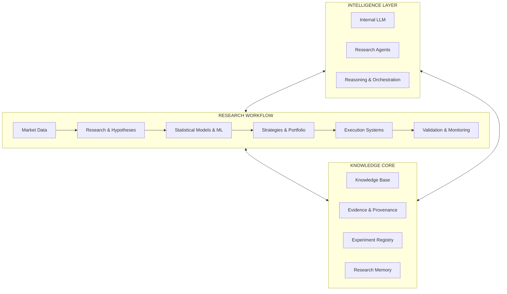

 

  

# QUANT FOUND RESEARCH OS

### A unified infrastructure for quantitative research, intelligence and systematic strategies.

 

**DATA · RESEARCH · MODELS · KNOWLEDGE · INTELLIGENCE · EXECUTION**

 

[Research Architecture](#system-architecture) · [Core Capabilities](#core-capabilities) · [Roadmap](#development-roadmap)

---

## 01. ABOUT

**Quant Found Research OS** is an independent research and engineering initiative focused on building a unified infrastructure for quantitative finance, systematic strategy development and AI-driven research.

The long-term vision is to create an integrated research environment capable of collecting and processing market data, discovering statistical relationships, formulating hypotheses, conducting experiments, validating models and transforming verified findings into systematic strategies.

The platform combines three fundamental concepts:

- **Research Workflow** — the operational environment for quantitative investigation.
- **Knowledge Core** — a persistent foundation for research knowledge, evidence and reproducibility.
- **Intelligence Layer** — an integrated AI infrastructure designed to assist and eventually automate research processes.

The ultimate objective is to build an independent research system with its own data infrastructure, knowledge base, computational capabilities and internal intelligence.

---

## 02. SYSTEM ARCHITECTURE

Quant Found is designed as an interconnected research infrastructure rather than a collection of independent trading algorithms.

### 2.1 Research Workflow

The operational layer responsible for the complete research lifecycle.

| Component | Responsibility |
|---|---|
| Data | Market data collection, normalization and storage |
| Research | Hypothesis generation and statistical investigation |
| Models | Statistical modeling, machine learning and prediction |
| Strategies | Alpha discovery and portfolio construction |
| Execution | Order management and trading infrastructure |
| Validation | Robustness testing and performance monitoring |

### 2.2 Knowledge Core

The persistent knowledge foundation of Quant Found.

Its purpose is to prevent research from becoming a collection of disconnected experiments.

Core responsibilities:

- Structured research knowledge.
- Hypothesis and experiment registry.
- Evidence management and source traceability.
- Statistical results and validation history.
- Research documentation and provenance.
- Reproducibility of experiments.
- Accumulation of accepted and rejected findings.

Every experiment should contribute to the accumulated knowledge of the system.

### 2.3 Intelligence Layer

The integrated intelligence infrastructure operating across the research workflow.

Planned capabilities:

- Self-hosted LLM infrastructure.
- Specialized research agents.
- Retrieval-augmented generation (RAG).
- Contextual reasoning and knowledge retrieval.
- Automated research orchestration.
- Hypothesis generation and analytical assistance.
- Integration with internal datasets, models and experiments.

The long-term objective is to minimize dependency on external LLM providers and establish an independently operated intelligence environment.

---

## 03. CORE CAPABILITIES

### Market Data Engineering

- Historical and real-time market data.
- Data normalization and quality control.
- High-volume time-series processing.
- Parquet-based storage infrastructure.
- Market microstructure research.

### Quantitative Research

- Statistical arbitrage.
- Pairs trading and relative-value strategies.
- Cross-sectional alpha research.
- Market-neutral strategies.
- Event-driven research.
- Time-series analysis.
- Statistical hypothesis testing.

### Modeling & Machine Learning

- Statistical models.
- Regression and classification.
- Gradient boosting.
- Time-series modeling.
- Feature engineering.
- Model evaluation and validation.

### Systematic Trading

- Portfolio construction.
- Position sizing.
- Risk management.
- Execution routing.
- Broker API integration.
- Trade reconciliation.
- Operational monitoring and recovery.

### Research Intelligence

- Knowledge retrieval.
- Internal LLMs.
- Research agents.
- Automated experimentation.
- Research memory.
- Evidence-based analytical reasoning.

---

## 04. RESEARCH PRINCIPLES

**Evidence over intuition**

Every research hypothesis must be translated into a measurable and falsifiable proposition.

**Statistical robustness over isolated performance**

Results must survive appropriate statistical testing, transaction costs and out-of-sample validation.

**Reproducibility over black boxes**

Datasets, assumptions, methodologies and results must remain traceable.

**Knowledge accumulation over repeated experiments**

Rejected hypotheses are valuable research outcomes when their conclusions are properly documented.

**Separation of research and production**

A promising backtest is not a production-ready strategy. Independent validation and operational controls are required.

**Infrastructure over temporary solutions**

Every component should contribute to a reliable, extensible and independently operable research environment.

---

## 05. DEVELOPMENT STATUS

Quant Found is an evolving research and engineering project. Its architecture includes existing infrastructure, active development and longer-term research objectives.

| Area | Status |
|---|---|
| Market data infrastructure | Implemented / Evolving |
| Historical data processing | Implemented |
| MOEX research and trading infrastructure | Implemented / Evolving |
| Crypto research data infrastructure | Implemented / Evolving |
| Statistical research pipeline | Implemented / Evolving |
| Quantitative strategy research | Active |
| Knowledge Core | Planned / In Development |
| Research experiment registry | Planned |
| Internal LLM infrastructure | Planned |
| Specialized research agents | Planned |
| Autonomous research orchestration | Planned |

*Status describes the overall project direction, not a guarantee that every component is production-ready.*

---

## 06. DEVELOPMENT ROADMAP

The long-term development strategy follows several stages.

### Phase 1 — Research Infrastructure

- Consolidate existing market data pipelines.
- Standardize research workflows.
- Establish reproducible experiments.
- Improve data quality and validation.
- Unify research documentation.

### Phase 2 — Knowledge Infrastructure

- Design the Knowledge Core architecture.
- Implement structured knowledge storage.
- Introduce hypothesis and experiment registries.
- Establish evidence and provenance tracking.
- Connect research results with accumulated knowledge.

### Phase 3 — Native Intelligence

- Establish local LLM infrastructure.
- Evaluate and integrate open-weight models.
- Build knowledge retrieval mechanisms.
- Develop specialized research agents.
- Introduce controlled reasoning and orchestration.

### Phase 4 — Research Automation

- Automated hypothesis discovery.
- Research experiment generation.
- Statistical evaluation and validation.
- Automated research reporting.
- Integration of agents with the research workflow.

### Phase 5 — Autonomous Research Environment

- Continuous research cycles.
- Knowledge-driven hypothesis generation.
- Automated experimentation.
- Independent validation.
- Human-supervised research decisions.
- Integration of validated strategies into production infrastructure.

---

## 07. TECHNOLOGY STACK

**Core Engineering**

Python · Linux · Docker · Git

**Data Infrastructure**

Polars · NumPy · PostgreSQL · Parquet

**Quantitative Research**

SciPy · Statistical Modeling · Time Series Analysis · Machine Learning

**AI Infrastructure**

Local LLMs · Open-Weight Models · RAG · AI Agents · Knowledge Retrieval

**Systems & Interfaces**

TypeScript · REST APIs · Broker Integration · Monitoring

*Technology selection evolves alongside system requirements.*

---

## 08. PROJECT PHILOSOPHY

Quant Found is built around a simple idea:

**A quantitative research system should become more capable as it accumulates data, experiments and verified knowledge.**

The value of the infrastructure is not limited to the performance of individual trading strategies.

It comes from the ability to continuously:

- Observe markets.
- Discover relationships.
- Formulate hypotheses.
- Conduct experiments.
- Validate evidence.
- Preserve knowledge.
- Improve research processes.

The long-term ambition is to create an independent quantitative research environment where data, knowledge, computation and intelligence operate as one integrated system.

---

## QUANT FOUND

### RESEARCH OS

*Building systems that turn market data into measurable knowledge and systematic decisions.*

 

**MAKSIM OSTROVSKII**

Founder & Independent Research Engineer

 

[GitHub](https://github.com/ostmax)

 

Independent quantitative research and engineering initiative · Private R&D

